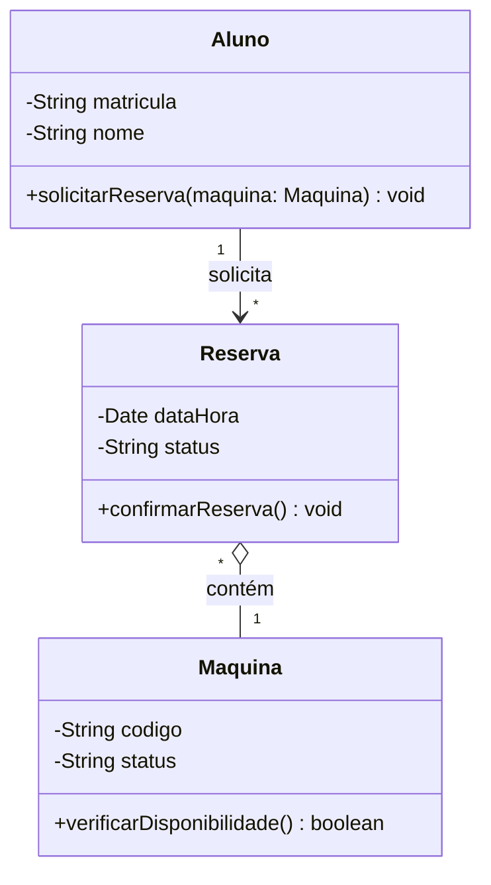

# Diagrama de Classes — Do Comportamento para a Estrutura

## 1. Onde Estamos e para Onde Vamos?
- **Transição de Perspectiva:** Saímos da perspectiva funcional (Casos de Uso — "o que o sistema faz") para a **Perspectiva Estrutural** (Diagrama de Classes — "o que o sistema é / sua planta baixa estática").
- **Link com o 3º Período (POO em Java/C++):**
  - No 3º período: foco na **sintaxe** (como escrever classes, atributos e métodos).
  - No 4º período: foco no **design** (quais classes devem existir, como se comunicam e quais responsabilidades assumem no domínio).

---

## 2. Anatomia da Classe na UML e Modificadores
Uma classe é dividida em 3 compartimentos obrigatórios:
```text
+------------------------------------------+
|               Consultation               | <--- 1. Nome da Classe (Substantivo, Singular)
+------------------------------------------+
| - date: Date                             | <--- 2. Atributos (Dados e Visibilidade)
| - reason: String                         |
+------------------------------------------+
| + prescribe(med: Medication): void       | <--- 3. Métodos / Operações (Comportamento)
| + recordNotes(): void                    |
+------------------------------------------+
```

### Modificadores de Visibilidade:
- `-` **Privado (Private):** Visível apenas dentro da própria classe (Encapsulamento).
- `+` **Público (Public):** Acessível por qualquer classe.
- `#` **Protegido (Protected):** Visível para a classe e suas subclasses (Herança).
- `~` **Pacote (Package):** Visível apenas para classes do mesmo pacote.

---

## 3. Relacionamentos e Semânticas Técnicas
1. **Associação Simples (`-->`):** Conexão lógica duradoura onde uma classe conhece a outra (com multiplicidades: `1`, `0..*`, `1..*`).
2. **Agregação (`o--`):** Relação "todo-parte" fraca. As partes existem sem o todo (ex.: *Biblioteca possui Livros* — se a biblioteca fechar, os livros continuam existindo).
3. **Composição (`*--`):** Relação "todo-parte" forte. O ciclo de vida da parte depende do todo (ex.: *Pedido e ItensPedido* — se o pedido for excluído, os itens não fazem sentido órfãos).
4. **Generalização / Herança (`^--`):** Especialização. A subclasse herda atributos e métodos da superclasse (ex.: `PaymentMethod` -> `PixPayment`, `CreditCardPayment`).

---

## 4. Filosofia de Modelagem: "Ver vs. Enxergar"
- **O iniciante apenas "Vê" (foco em dados):** Cria uma classe monstro `Usuario` com 50 colunas misturando login, senha, CPF, dados de entrega, endereço e cargo.
- **O profissional "Enxerga" (foco em responsabilidade):** Decompõe o domínio. Separa dados de *Identificação* (Nome, CPF) de dados de *Autenticação* (Login, Hash de Senha) e papéis (*Técnico de Segurança*, *Supervisor*, *Operador*).

---

## 5. C4 Nível 4 (Code) e Diagrams-as-Code (Mermaid)
- O **C4 Model Nível 4 (Code)** detalha classes críticas da arquitetura.
- **Diagrama de Classes vs Diagrama de Objetos:**
  - *Classes (Abstrato):* O contrato e as regras estáticas.
  - *Objetos (Concreto):* Um snapshot estático da memória RAM em tempo de execução com valores reais (ex.: `meuCarro: Carro` com `placa = "ABC-1234"`).

### Sintaxe Mermaid (DaC):


