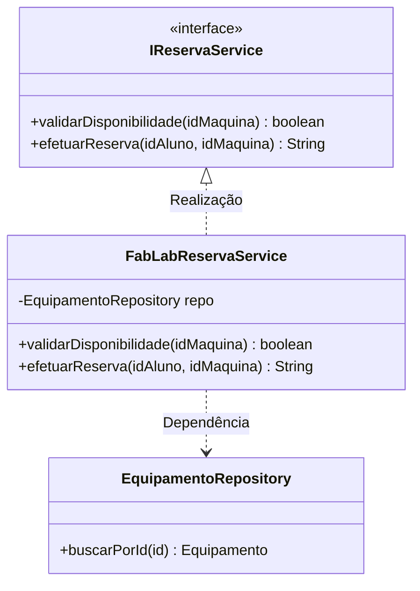

# Relacionamentos Avançados e Reuso em Modelagem de Software

## 1. Da Estrutura Básica ao Design Orientado a Reuso
- Saída do acoplamento rígido para **arquiteturas desacopladas e reutilizáveis**.
- Aplicação prática dos pilares do **SOLID** e do padrão de projeto GoF: *"Prefira composição à herança"*.
- **Conexão com Back-End (4º Período):** As interfaces UML sustentam a **Injeção de Dependência (DI)** e a **Inversão de Controle (IoC)** em Spring Boot, NestJS e .NET.

---

## 2. "Ver" vs. "Enxergar" no Reuso
- **O Mito do Copiar e Colar:** Duplicar código gera dívida técnica em dobro.
- **Iniciante:** Usa herança concreta cega (`PagamentoCartao` herda de `ProcessadorPagamento`). Se o pai muda, tudo quebra (*Fragile Base Class Problem*).
- **Engenheiro:** Modela uma interface `<<interface>> IPagamentoService` com o método `processar(valor)` e aplica **Realização**, permitindo trocar o fornecedor (Stripe, Stone, Mercado Pago) sem refatorar o núcleo de regras.

---

## 3. Mecanismos Avançados da UML

### A. Classes Abstratas ({abstract}) vs Interfaces (`<<interface>>`)
| Critério | Classe Abstrata (`{abstract}`) | Interface (`<<interface>>`) |
| :--- | :--- | :--- |
| **Propósito** | Base parcial comum; compartilha código e estado. | Contrato puro de comportamento sem implementação. |
| **Atributos** | Atributos privados, protegidos e de instância. | Apenas constantes públicas estáticas (`final`). |
| **Métodos** | Concretos e abstratos. | Apenas assinaturas de métodos públicos. |
| **Conector UML**| Generalização / Herança (`^--`). | Realização / Implementação (`<|..`). |

### B. Realização / Implementação (`<|..`)
Conecta uma classe concreta a uma Interface que ela promete cumprir (linha tracejada com seta triangular vazia).

### C. Dependência (`<..`)
Vínculo fraco e temporário de execução. A Classe A "usa" a Classe B (como parâmetro de método ou variável temporária local), mas não armazena B como atributo permanente.

### D. Classes de Associação
Usada quando o relacionamento entre duas classes possui **dados próprios** que não pertencem exclusivamente a nenhuma delas.
- *Exemplo:* `Estudante` e `Disciplina` (Muitos para Muitos). Onde guardar a `notaFinal` e `frequencia`? Na classe de associação `Matricula`.

### E. Associações Qualificadas e Auto-Associação (Reflexiva)
- **Qualificada:** Reduz a multiplicidade de 1-para-N para 1-para-1 usando uma chave/índice.
- **Auto-Associação (Reflexiva):** Um objeto se relaciona com outros da mesma classe (ex.: `Funcionario` que é gerente de outros `Funcionarios`; `Peca` composta de subpeças no padrão *Composite*).

---

## 4. Os Quatro Níveis de Reuso de Sommerville
1. **Reuso de Funções/Métodos:** Algoritmos matemáticos e bibliotecas utilitárias puras.
2. **Reuso de Classes:** Hierarquias orientadas a objetos com herança, polimorfismo e interfaces.
3. **Reuso de Componentes:** Frameworks completos (Spring Boot, React, NestJS).
4. **Reuso de Serviços / APIs:** Microsserviços e Web Services distribuídos via rede (REST, gRPC, AMQP).

### Exemplo em Mermaid (DaC):

