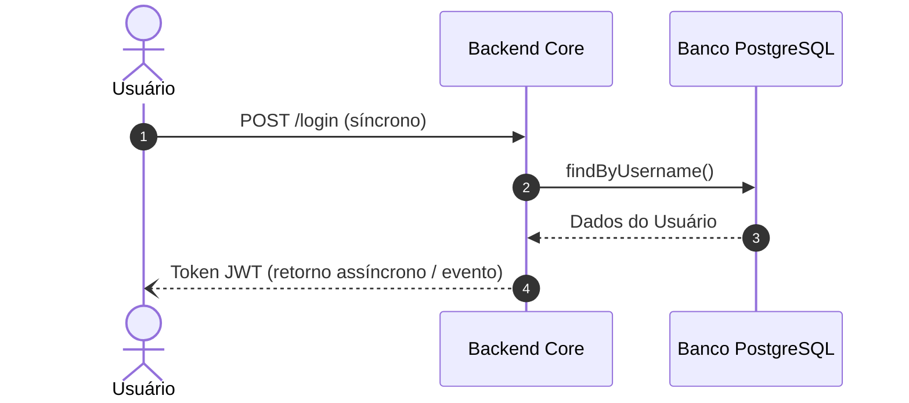
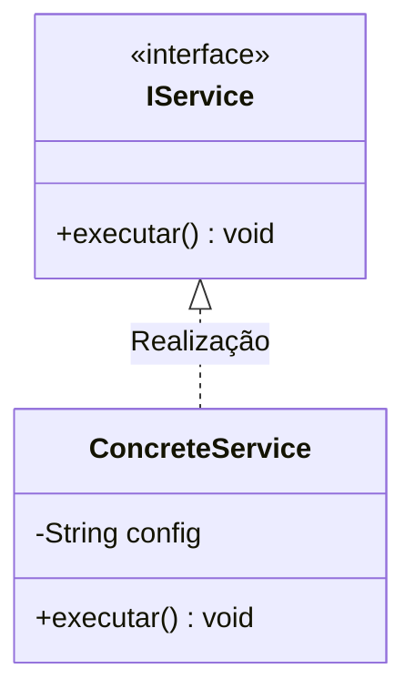
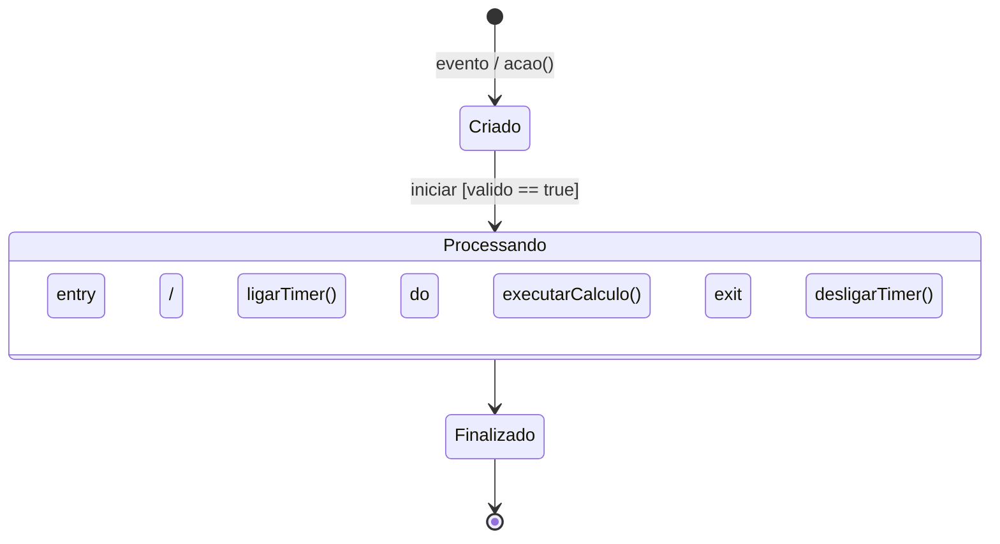
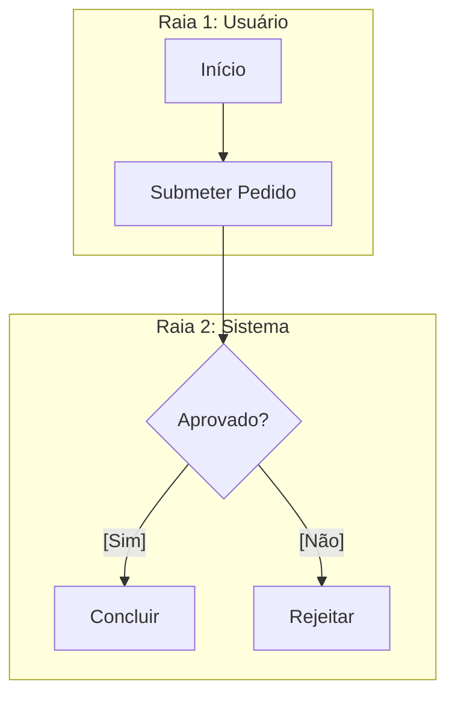

# Guia de Referência Rápida — Mermaid.js (Diagrams-as-Code)

- **Documentação Oficial:** [Mermaid.js Getting Started](https://mermaid.ai/open-source/intro/getting-started.html)
- **Repositório GitHub Oficial:** [github.com/mermaid-js/mermaid](https://github.com/mermaid-js/mermaid)

---

## 1. O que é o Mermaid.js?
O **Mermaid.js** é uma ferramenta de código aberto baseada em JavaScript que utiliza definições de texto inspiradas no Markdown para gerar diagramas, gráficos e modelos complexos dinamicamente no navegador ou no GitHub.

No paradigma **Diagrams-as-Code (DaC)**, o Mermaid elimina a necessidade de desenhar imagens manuais, permitindo versionar arquitetura e comportamento de software como código no Git.

---

## 2. Tipos Principais de Diagramas e Palavras-Chave

### A. Diagrama de Sequência (`sequenceDiagram`)

- Conectores:
  - `->>` : Chamada síncrona com ponta cheia
  - `-->>`: Resposta pontilhada síncrona
  - `-)`  : Chamada assíncrona (fire-and-forget)
  - `alt / else / end`: Condicionais de execução
  - `loop / end`: Laços de repetição

---

### B. Diagrama de Classes (`classDiagram`)

- Modificadores: `+` público, `-` privado, `#` protegido, `~` pacote.
- Relações: `<|--` Herança, `<|..` Realização, `*--` Composição, `o--` Agregação, `-->` Associação, `..>` Dependência.

---

### C. Diagrama de Transição de Estados (`stateDiagram-v2`)

---

### D. Fluxogramas e Atividades com Raias (`flowchart TD / TB / LR`)

- Fork e Join: nós intermediários de bifurcação e sincronização para modelar paralelismo.
