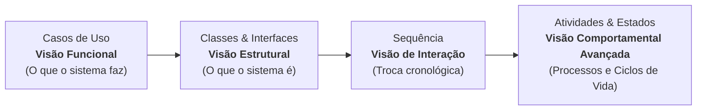
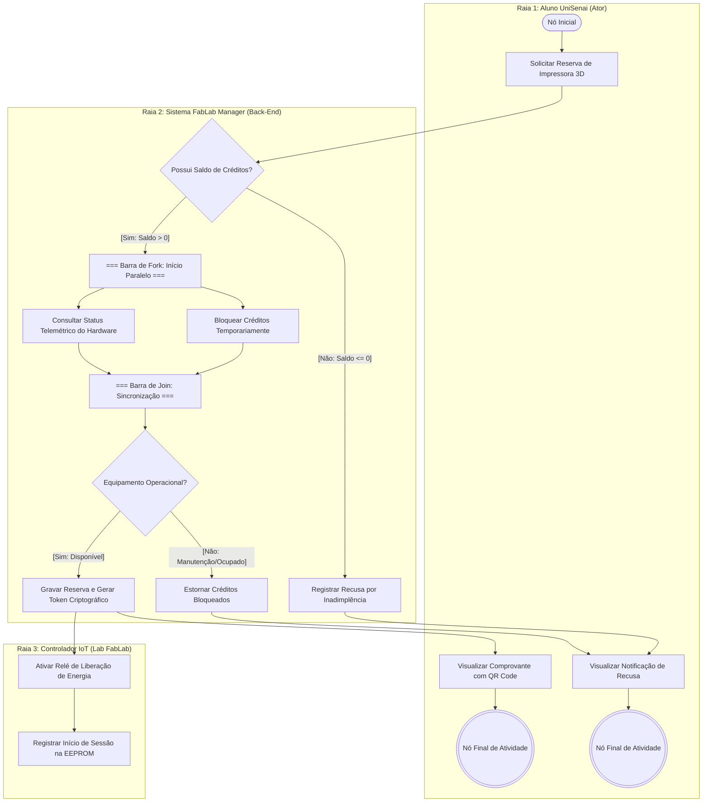
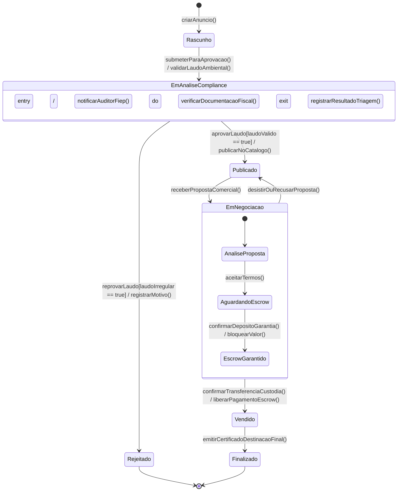

# Encontro 09: Diagramas de Atividades e Transição de Estados — Modelagem de Fluxos de Processo e Ciclos de Vida Reativos

**Unidade Curricular:** Modelagem de Software (4º Período – Engenharia de Software)  
**Carga Horária:** 4 horas-relógio (19:00 às 22:00)  
**Docente:** Sidney L. da Silva  
**Instituição:** UniSenai Paraná (Campus CIC / Campus da Indústria)  
**Metodologia:** Aula Teórico-Prática / Aprendizagem Baseada em Projetos (ABProj) / *Model Storming* com *Diagrams-as-Code* (Mermaid)

---

## 1. Conexão Pedagógica & Jornada de Aprendizagem

### Da Estrutura e Interação aos Processos de Negócio e Estados Críticos
Ao longo do semestre letivo de Modelagem de Software, desenvolvemos a capacidade analítica sob as três grandes perspectivas da Engenharia de Software clássica e ágil:

1. **Perspectiva Funcional (Encontro 04):** Mapeamos as fronteiras do software e a entrega de valor aos atores externos por meio dos **Diagramas de Casos de Uso**.
2. **Perspectiva Estrutural (Encontros 06 e 07):** Projetamos a organização lógica e estática ("o que o sistema é") através de **Diagramas de Classes, Interfaces, Dependências e Inversão de Controle**.
3. **Perspectiva Comportamental / Interação (Encontro 08):** Analisamos a dinâmica temporal e a orquestração síncrona e assíncrona de mensagens entre instâncias em execução com o **Diagrama de Sequência**.

Contudo, sistemas de nível corporativo e industrial não se limitam a invocações diretas de métodos. Eles incorporam **processos de negócio concorrentes** (que atravessam operadores humanos, dispositivos de IoT, filas de mensageria e serviços de terceiros) e **entidades de negócio de alta criticidade** cujo estado interno precisa ser protegido de transições inválidas ou corrupção lógica ao longo do tempo.

Neste **Encontro 09**, consolidamos a **Perspectiva Comportamental / Dinâmica** com dois modelos complementares da UML 2.x:
* **Diagrama de Atividades:** Projetado para mapear fluxos de trabalho (*workflows*), processos de negócio ponta a ponta, ramificações condicionais e processamento concorrente/paralelo (*fork/join*).
* **Diagrama de Transição de Estados (*State Machine*):** Projetado para descrever a evolução temporal, eventos disparadores (*triggers*), condições de guarda e efeitos colaterais no ciclo de vida de uma entidade do domínio.

---

## 2. Momento Motivacional: "Ver" vs. "Enxergar" no Comportamento Complexo

Modelar não é desenhar caixas de forma arbitrária; modelar é **abstrair a realidade de forma disciplinada para resolver um problema de negócio específico**.

### A. No Fluxo de Trabalho (Atividades)
* **O programador iniciante apenas "Vê" (Execução Estritamente Sequencial):** Diante de um processo de reserva ou compra, ele implementa todo o código de forma bloqueante: primeiro debita créditos, aguarda a resposta, depois verifica a telemetria do sensor físico, espera a confirmação e só então responde à interface web.
* **O engenheiro de software experiente "Enxerga" (Concorrência e Divisão de Papéis):** Ao desenhar o **Diagrama de Atividades com Raias (*Swimlanes*)**, ele identifica que tarefas independentes (como bloquear créditos temporários e consultar o sensor IoT de hardware) podem rodar **em paralelo (`fork/join`)**, reduzindo drasticamente o tempo de resposta da transação. Ele também atribui com exatidão a responsabilidade de cada etapa entre o Ator, o Back-End e o Hardware.

### B. No Ciclo de Vida da Entidade (Máquina de Estados)
* **O programador iniciante apenas "Vê" (Status como Strings Soltas):** Ele cria uma coluna `status VARCHAR(30)` na tabela do banco de dados e altera seu valor livremente nos métodos: `pedido.setStatus("CANCELADO")`.
  * *O desastre em produção:* Por falta de validação formal do ciclo de vida, uma requisição concorrente ou falha de interface pode alterar o status de um pedido já `"FINALIZADO"` ou `"ENTREGUE"` de volta para `"PROCESSANDO"`, gerando cobrança duplicada ou nova expedição indevida da mercadoria.
* **O engenheiro de software experiente "Enxerga" (Máquina de Estados Finita - FSM):** Ele modela o **Diagrama de Transição de Estados**. Ele documenta quais eventos provocam mudanças, estabelece **condições de guarda** e define claramente os **Estados Terminais**. Se o sistema receber um comando de cancelamento sobre uma entidade finalizada, a transição é barrada na camada de domínio com uma exceção de integridade (`InvalidStateTransitionException`).

---

## 3. Exemplo Prático em Mermaid: Diagrama de Atividades com Raias (FabLab Manager)

---

## 4. Exemplo Prático em Mermaid: Máquina de Estados v2 (LoteDeResiduo)

---

## 5. Preview do Modelo C4 (Níveis 1, 2 e 3)
No próximo encontro, encerraremos a visão microscópica de classes e métodos para dar o salto definitivo em direção à **Arquitetura de Software Macro Corporativa**. 

Aplicaremos o **Modelo C4 concebido por Simon Brown**, utilizando as metáforas de zoom estruturado (estilo Google Maps) para modelar os diagramas de **Contexto (L1)**, **Contêineres (L2)** e **Componentes (L3)** de sistemas modernos orientados a microsserviços, nuvem e contêineres Docker.

