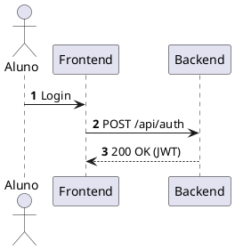

# Guia Prático de Instalação e Uso: PlantUML, D2 e Structurizr DSL

- **PlantUML:** [plantuml.github.io/plantuml](https://plantuml.github.io/plantuml/index.html)
- **D2 (D2lang):** [d2lang.com](https://d2lang.com/)
- **Structurizr DSL:** [docs.structurizr.com/dsl](https://docs.structurizr.com/dsl)

---

## 1. PlantUML (Diagrams-as-Code — Padrão UML e C4)
- Ferramenta baseada em Java que compila texto declarativo em diagramas.
- **Pré-requisitos:** Java 11+ e Graphviz (`winget install Graphviz.Graphviz` no Windows).
- **Extensão VS Code:** "PlantUML" (desenvolvida por jebbs). Atalho de preview: `Alt + D`.
- **Sintaxe básica (`.puml`):**


---

## 2. D2 — D2lang (Layout Moderno e Avançado)
- Binário compilado único (sem dependência de Java ou Graphviz).
- **Instalação Windows:** `winget install d2`.
- **Modo Watch no Navegador:** `d2 -w arquivo.d2`.
- **Exportação:** `d2 arquivo.d2 arquitetura.svg`.
- **Vantagem:** Motores de layout avançados (Dagre, ELK, TALA) que evitam cruzamento de linhas.

---

## 3. Structurizr DSL (Models-as-Code — C4 Model Centralizado)
- O padrão da indústria para implementar C4 Model como código único (*Single Source of Truth*).
- **Sintaxe básica (`workspace.dsl`):**
```text
workspace "Sistema" "Descrição" {
    model {
        user = person "Usuário"
        app = softwareSystem "Meu Sistema" {
            api = container "Backend API" "Spring Boot"
            db = container "Database" "PostgreSQL"
        }
        user -> api "Acessa"
        api -> db "Lê/Grava"
    }
    views {
        systemContext app "Contexto" { include * }
        container app "Conteineres" { include * }
    }
}
```
- **Exportação para Mermaid:** `structurizr-cli export -f mermaid -w workspace.dsl`.

---

## 4. Matriz de Escolha Rápida
| Necessidade do Projeto | Ferramenta Indicada | Fluxo Recomendado |
| :--- | :--- | :--- |
| **Diagrama rápido no README / GitHub** | **Mermaid.js** | Bloco ````mermaid direto no Markdown. |
| **UML formal rigorosa e macros C4** | **PlantUML** | Arquivos `.puml` via extensão VS Code. |
| **Diagrama complexo sem cruzamento de linhas** | **D2** | Arquivos `.d2` com modo watch no browser. |
| **Modelo C4 centralizado sem redundância (SSOT)** | **Structurizr DSL** | Arquivo `workspace.dsl` gerando todas as visões. |
