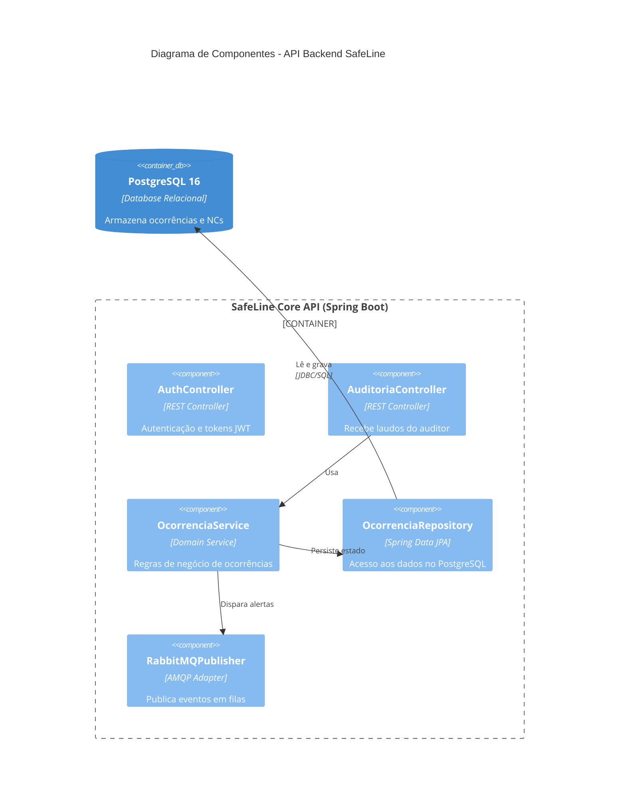

# Modelo C4 Nível 3 (Componentes) e Governança de Arquitetura (ADRs)

## 1. Do Zoom em Contêineres (L2) à Decomposição Interna (L3)

### Os 4 Níveis do Modelo C4 (Simon Brown):
| Nível | Nome | Foco |
| :--- | :--- | :--- |
| **1** | **Contexto** | Ecossistema global, atores humanos e sistemas externos. |
| **2** | **Contêineres** | Unidades de implantação (Web App, API backend, Banco, Fila RabbitMQ). |
| **3** | **Componentes** | Zoom interno dentro de um contêiner (Controllers, Services, Repositories). |
| **4** | **Código** | Classes, interfaces e métodos individuais (UML micro). |

> **Nota Crítica:** Todos os componentes do C4 Nível 3 rodam **dentro do mesmo processo/espaço de memória** do contêiner pai (não são microsserviços separados).

---

## 2. "Ver" vs. "Enxergar" — Evitando o Monólito Oculto (*Big Ball of Mud*)
- **Iniciante:** Divide o projeto em pastas `/controllers`, `/services`, `/repositories`, mas deixa o Controller acessar o banco diretamente via SQL, pulando regras de negócio e acoplando tudo.
- **Engenheiro:** Desenha o diagrama C4 Nível 3 definindo fronteiras estritas. Cria uma **ADR** que proíbe chamadas diretas da camada de apresentação para a persistência e valida isso com linters na esteira de CI/CD.

---

## 3. Exemplo Prático de Componentes C4 Nível 3 (Mermaid)

---

## 4. Governança de Arquitetura & ADRs (Architecture Decision Records)
Um **ADR** é um documento curto em texto/Markdown que captura uma decisão arquitetural significativa, seus porquês e seus trade-offs.

### Estrutura Padrão (Formato Michael Nygard):
- **Título:** `ADR 0001: [Nome da Decisão]`
- **Status:** Proposto | Aprovado | Depreciado | Substituído
- **Contexto:** Qual o problema técnico ou de negócio que estamos enfrentando?
- **Decisão:** Qual tecnologia, padrão ou protocolo foi adotado e por quê?
- **Consequências:**
  - `[+] Vantagens e Ganhos:` O que melhorou?
  - `[-] Débitos e Riscos Aceitos:` Qual foi o preço pago pela decisão? (Análise de trade-offs).
